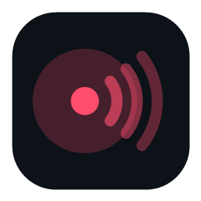

<p align="center">
  
</p>

<h1 align="center">Beamcast</h1>

<p align="center">
  <strong>Salas de compartilhamento de tela, self-hosted e cifradas de ponta a ponta.</strong><br />
  Projeto de estudo sobre captura, codecs, áudio por processo e transmissão em tempo real no Windows.
</p>

<p align="center">
  
  
  
  
</p>

---

## Leia isto primeiro

**O Beamcast existe apenas para estudo.** Ele foi escrito para explorar como captura de tela,
codificação de vídeo por hardware, áudio por processo e um protocolo de transmissão se
encaixam no Windows, e para produzir conclusões e código de referência para um aplicativo
empresarial separado e privado. Cada decisão prioriza aprendizado e medição, não uso em produção.

- **Sem garantia, sem responsabilidade.** O software é fornecido "como está". O autor não se
  responsabiliza por nada que aconteça ao executar, distribuir ou construir em cima dele.
- **Qualquer outro uso é responsabilidade sua.** Se você usar o Beamcast para algo além de
  estudar o código, faz isso por sua conta e risco, e é responsável por cumprir as leis,
  políticas e exigências de consentimento que se aplicam a você. Compartilhar a tela expõe
  tudo o que estiver nela; pense antes de transmitir.
- **Sem suporte, sem promessa de roadmap.** Issues podem ficar sem resposta; o protocolo e a
  organização dos arquivos podem mudar a qualquer momento.
- **Não é endurecido para produção.** O conteúdo vai cifrado de ponta a ponta e a senha nunca
  trafega, mas não houve auditoria de segurança. Use em ambientes que você controla.

O mesmo aviso aparece dentro do app no primeiro uso e na página Sobre.

## Como funciona

1. Alguém sobe o **host** (o servidor, um container Docker) em qualquer máquina alcançável:
   um VPS, o PC de casa atrás de um túnel, um servidor na LAN. Um host tem quantas salas quiser.
2. No app, você adiciona o host à sua lista (e pode favoritá-lo). Ao selecioná-lo, vê as
   **salas** dele (as com senha aparecem com cadeado), suas **salas favoritas** naquele host, um campo para **código ou
   convite**, e o botão **Criar sala**.
3. Uma sala tem nome, duração (**permanente** ou **temporária**, que some depois de ficar vazia
   pelo tempo escolhido), **senha opcional** (o cadeado na lista), quem pode transmitir (todo
   mundo ou só o dono) e limite de pessoas. Toda sala do host aparece na lista; a senha é o que
   controla quem entra.
4. Dentro da sala todo mundo vê quem está online e quais transmissões existem. Qualquer membro
   transmite (várias ao mesmo tempo, salvo se o dono restringir), cada um escolhe o que assistir
   e pode parar sem sair.
5. O **dono** (quem criou) tem a aba **Configurações** dentro da sala: gera **convites com
   validade** (1 h, 24 h, 7 dias ou sem prazo) e número de usos, edita a sala, troca ou remove a
   senha, revoga convites e apaga a sala; expulsa gente pela lista de quem está online. Na tela
   Salas, o menu "⋯" de cada sala copia o convite, favorita e, nas suas, edita ou apaga sem
   entrar. O token de dono fica só no PC de quem criou, protegido pelo Windows (DPAPI). Salas
   antigas sem dono passam a ser da primeira pessoa que entrar.
6. **Qualidade adaptativa**: se o seu upload não acompanha, o bitrate cai em degraus e volta
   sozinho; o valor escolhido é o teto. Espectador atrasado só baixa o bitrate quando pelo menos
   metade deles está atrasada, para um não piorar a imagem de todos. Cada transmissão assistida mostra o **atraso real** e o
   ping, dá para **assistir várias ao mesmo tempo** em grade, e quem transmite ouve um **som** e vê
   o nome quando alguém entra ou sai da transmissão (host 2.3.0+).
7. Se a internet cair, do seu lado ou do host, o app **reconecta sozinho** por até 5 minutos,
   republica a sua transmissão e volta a assistir o que você assistia. A sala continua existindo
   no host; ninguém precisa reenviar convite.
8. **Conexão direta (P2P)**: o vídeo começa pelo host e, quando a rede deixa, passa a ir direto
   de quem transmite para quem assiste. Cada transmissão mostra "Direto" ou "Via servidor" e o
   app avisa quando o caminho muda. Veja [Conexão direta](#conexão-direta-p2p).

## Conexão direta (P2P)

O host continua cuidando da sala (membros, transmissões, chaves) e repassando o vídeo. Por cima
disso, desde a 3.1.0 o app tenta um caminho direto entre os dois PCs:

1. Quem assiste assina a transmissão pelo host, como sempre, e a imagem aparece na hora.
2. Quem transmite oferece um link direto a cada espectador com app 3.1.0+. A negociação vai pelo
   canal de controle da sala, cifrada com a chave da sala; o host só repassa.
3. Quando o link abre, chega um keyframe por ele. O espectador troca de caminho nesse quadro e
   cancela a cópia do host. Se todos os espectadores estão no direto, o transmissor para de
   enviar ao host.
4. Se o link cair, o espectador volta para a cópia do host na hora, e o transmissor tenta de
   novo depois de 20 s, 1, 3 e 10 minutos.

O que vale saber:

- **Ninguém abre porta.** O link é um data channel WebRTC sobre UDP que atravessa os roteadores
  com STUN (`stun.cloudflare.com` e `stun.l.google.com`, que só veem o seu IP público). Em redes
  que bloqueiam UDP ou atrás de alguns CGNAT o link não fecha, e o vídeo segue pelo host.
- **O seu IP fica visível para as pessoas da sala.** É inerente ao P2P. Para evitar, desligue em
  Configurações → "Conexão direta (P2P)".
- **Nada muda no host.** Hosts antigos repassam a negociação como qualquer mensagem de controle,
  e apps antigos continuam pelo host.
- **O upload passa a ser de quem transmite**: uma cópia do vídeo por espectador direto.
- **Qualidade por espectador**: quem está no link direto e não acompanha recebe uma versão
  reduzida só para si (metade da altura, um quarto do bitrate), feita por um segundo encoder que
  só roda enquanto alguém precisa. Os demais seguem com a imagem cheia, e o app tenta devolver a
  pessoa à versão cheia depois de um tempo sem problemas. Quem assiste pelo host recebe sempre a
  versão cheia.
- **O conteúdo continua cifrado de ponta a ponta** com a chave da sala; o DTLS do WebRTC é uma
  segunda camada.
- O link é confiável e ordenado, como o WebSocket. Quando ele fica para trás, o transmissor
  segura quadros nesse link, recomeça num keyframe e baixa o bitrate (qualidade adaptativa).

## Segurança

O host nunca recebe senha nem chave e não consegue ver nem ouvir nada:

```
Salas com senha
  chave       = PBKDF2-SHA256(senha, salt, 200 000 rodadas)   fica só nas máquinas dos membros
  verificador = HMAC(chave, "verify")                          o host guarda isto na criação
  prova       = HMAC(verificador, nonce)                        quem entra envia; o host confere
  conteúdo    = HKDF(chave, "content")                          AES-256-GCM em nomes, títulos, vídeo e áudio

Salas sem senha
  chave da sala = aleatória, gerada pelo primeiro a entrar e guardada só pelos membros
  quem entra manda uma chave pública efêmera (ECDH P-256); um membro embrulha a chave da sala
  para ela (HKDF + AES-256-GCM) e o host apenas repassa o pacote, sem conseguir abri-lo

Convites e dono
  o convite carrega host, código, um token com validade/usos (o host guarda só o hash) e, em
  salas com senha, a chave de conteúdo; o token de dono também é guardado só como hash
```

Entradas erradas (senha, convite, código) são limitadas por endereço e por sala com janela de
10 minutos. Salas criadas antes da 2.5.0 como "privadas" usam códigos de 10 caracteres. O host só lê o tipo de cada mensagem
e a flag de keyframe, que usa para descartar quadros de um espectador lento e pedir um keyframe
ao transmissor sem prejudicar os outros. A negociação da conexão direta passa pelo host cifrada
com a chave da sala, como o resto.

## Subir o host (quem hospeda)

Precisa só de Docker com Compose. Sem Actions, sem registry, sem conta:

```bash
git clone https://github.com/trupper9/Beamcast.git
cd Beamcast
docker compose up -d --build
```

O host escuta na porta `47710`. No app, o endereço é `ws://SEU-IP:47710` (ou só `SEU-IP`).
Variáveis opcionais num `.env` ao lado do `docker-compose.yml`:

| Variável | Efeito |
| --- | --- |
| `BEAMCAST_PORT` | porta publicada no host (padrão `47710`) |
| `BEAMCAST_HOST_NAME` | nome que o app mostra para este host (padrão: nome da máquina) |
| `BEAMCAST_APP_KEY` | quando definida, o app precisa carregar a mesma chave (na lateral, menu "⋯" do host → chave do host; o app também pede a chave na tela quando o host exige) |
| `BEAMCAST_LOUNGE_TTL_HOURS` | tempo padrão que uma sala **temporária** sobrevive vazia (padrão `24`) |

As salas (código, nome, configurações, salt e verificador, hashes de convites e do dono; nunca
conteúdo) ficam no volume `beamcast_data` e sobrevivem a reinícios. `GET /health` mostra salas,
membros e transmissões ativos; `GET /rooms` lista todas as salas.

**Pela internet:** abra a porta `47710/tcp` no roteador, ou coloque o container atrás de um
reverse proxy/túnel com TLS (Cloudflare Tunnel, Caddy, nginx) e use `wss://seu-host` no app.
Como todo membro só faz conexão de saída, CGNAT e firewall de quem entra não importam.

**Banda:** o host recebe cada transmissão uma vez e reenvia uma vez por espectador. 1080p60 a
~12 Mbps por espectador; 4K60 H.264 a ~40 Mbps; HEVC gasta ~35% menos e AV1 ~45% menos.
Espectadores em conexão direta não passam pelo host: esse tráfego sai do upload de quem transmite.

**Conexão direta:** não exige nada do host, nem porta UDP. Funciona igual com o host atrás de
Cloudflare Tunnel ou de um proxy, porque só a negociação passa por ele.

## O que o app faz

- **Captura** de monitor por DXGI Desktop Duplication (sem a borda amarela do Windows, cursor desenhado
  na GPU) e de janela pela Windows Graphics Capture API; tudo fica na GPU.
- **Vídeo**: conversão BGRA→NV12 no D3D11 Video Processor e encoder H.264/HEVC/AV1 por hardware
  via Media Foundation (AMD, NVIDIA, Intel, D3D12) com perfil de baixa latência; VP8 por software
  como reserva. O app testa o encoder antes de transmitir e cai para o próximo codec se ele não
  responder. A lista de codecs diz quem codifica (placa NVIDIA, AMD ou Intel, ou o processador).
  Decodificação DXVA direto para um `SwapChainPanel`.
- **Opções do encoder** (em "Mais opções", só para a placa de vídeo): **bitrate variável**
  (o escolhido vira a média, com pico de até 1,5x; numa RX 6750 XT um quadro parado cai de
  ~25 kB para ~50 B) e **otimizar para tela** (avisa o driver que a imagem é uma área de
  trabalho). Se o driver recusar, o app segue com bitrate constante.
- **AV1** aparece quando a placa tem encoder AV1 (RTX 40/50, RX 7000/9000, Intel Arc). Quem
  assiste precisa de um decodificador AV1 (no Windows, a "Extensão de Vídeo AV1" da Store).
- **Áudio**: loopback **por processo** (a mesma API que Discord e Teams usam). Ao compartilhar
  uma janela, captura só o app dela; ao compartilhar a tela inteira, captura todos os apps com
  sessão de áudio **exceto** Discord, Teams, Zoom, Slack, WhatsApp e afins, para a voz da chamada
  não ser retransmitida. Mixagem em quadros de 20 ms e Opus a 128 kbps, com ocultação de perda
  no receptor.
- **Rede**: um WebSocket por membro, heartbeat a cada 10 s (quem some é removido em 30 s mesmo
  atrás de proxy), mensagens cifradas, keyframe sob demanda, fila por espectador no host,
  reconexão automática. No envio, áudio e controle passam na frente do vídeo e quadros velhos
  são descartados quando há um keyframe mais novo na fila. Por cima disso, a **conexão direta**
  (data channel WebRTC) leva o vídeo de PC a PC quando dá. Presets até 2160p/120 fps.
- **Painel de conexão**: quem transmite vê cada espectador com o caminho (direto ou via
  servidor), o atraso que ele reportou e os quadros segurados no link direto.

## Compilar

Requisitos: Windows 10 1809+ (Windows 11 recomendado; áudio por processo pede build 20348+),
.NET 8 SDK.

```powershell
dotnet build Beamcast.sln -c Release
dotnet test tests/Beamcast.Tests
dotnet run --project src/Beamcast
```

Os testes cobrem a lógica pura, dois links diretos na mesma máquina e o cliente do app contra o
host de verdade: o próprio teste sobe o `Beamcast.Server` deste repositório em `127.0.0.1`, numa
porta livre e com uma pasta de dados temporária, e o encerra no fim. Nenhum endereço real é
usado. O workflow `CI` roda tudo isso a cada push e pull request.

O host também roda sem Docker: `dotnet run --project src/Beamcast.Server` (porta 8080).
`scripts/pack.ps1` gera o MSI com Velopack; os workflows do GitHub publicam o release do app
a partir da versão do csproj, e o app procura atualizações no GitHub Releases.

Para depurar, crie um arquivo vazio `%LOCALAPPDATA%\Beamcast\diag.on` (ou defina
`BEAMCAST_DIAG=1`): o app escreve `diag.log` na mesma pasta com eventos de encoder, keyframe,
fila e conexão direta (linhas `p2p:`). O mesmo registro liga em Configurações.

### Ainda não testado em uso real (3.1.x)

- Conexão direta entre dois PCs em redes diferentes. Os testes cobrem dois links na mesma máquina.
- AV1 numa placa com encoder AV1.
- Bitrate variável e "otimizar para tela" em NVIDIA e Intel (medidos só em AMD).
- Qualidade por espectador com um espectador real numa rede ruim (os dois encoders juntos e a
  troca de tamanho no decodificador foram medidos numa AMD).

## Organização

```
src/Beamcast          app WinUI 3
├── Capture/          Windows.Graphics.Capture + D3D11, enumeração de fontes
├── Codec/            VP8, encoders/decoders Media Foundation, conversor de vídeo
├── Audio/            loopback por processo, seletor de fontes, mixer, Opus, player
├── Net/              protocolo das salas, criptografia, convites, cliente, limitador, PeerLink (link direto)
├── Services/         LoungeService (sala + reconexão; .Direct = conexão direta), BroadcastService, WatchService, UpdateService
├── Logic/            presets, bitrate adaptativo, perfis, diagnóstico
└── Pages/            Salas (listagem), Sala, diálogos, Configurações, Sobre; os hosts ficam na lateral (MainWindow.SideBar)
src/Beamcast.Server   host (ASP.NET Core, WebSocket + listagem HTTP): LoungeHub (salas e admissão), Room (uma sala)
tests/Beamcast.Tests  testes xunit: lógica pura, link direto e o cliente contra o host em 127.0.0.1
docker-compose.yml    sobe o host a partir do código
```
